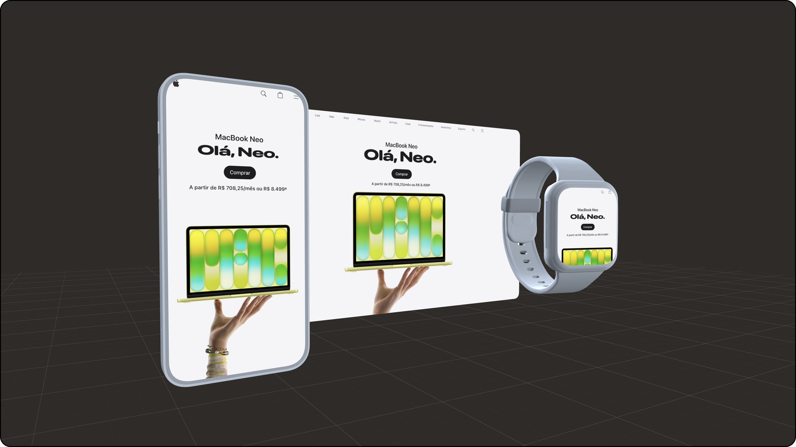

<p align="center">
  
</p>

<h1 align="center">Mock Studio</h1>

<p align="center">
  <strong>Put your screens inside 3D devices — and export a PNG or an animated video, right from the browser.</strong>
</p>

<p align="center">
  <a href="https://www.mockstudio.app.br"><strong>Open the editor →</strong></a>
</p>

<p align="center">
  
  
  
  
  
  
</p>

<p align="center">
  <a href="#features">Features</a> •
  <a href="#quick-start">Quick start</a> •
  <a href="#how-it-works">How it works</a> •
  <a href="#contributing">Contributing</a> •
  <a href="#model-catalog">Model catalog</a>
</p>

Mock Studio is an open source editor for marketing shots and product videos. Drop phones, a watch, a notebook and a tablet into a 3D scene, put an image or a screen recording on each screen, frame the camera and export. Everything runs on your machine: there is no account, no upload and no backend.

## Features

### Compose

- **Seven devices** — three phones, a foldable that opens and closes, a smartwatch, a notebook and a tablet — side by side in one scene, each with its own position, rotation, scale and opacity.
- **Images or screen recordings** on every screen (PNG, JPEG, WebP, MP4, MOV, WebM), with zoom, position — far enough to slide the content off the screen — background color and edge cropping. HDR recordings from iPhone and Mac are converted to show their real colors.
- **The device** is one row too: it shows the chosen model, and the row opens a panel with the list of devices and the body options (the body itself, the notebook's keyboard, and the screen bezel on the tablet and the Duo — on the Duo it hides the black ring around both screens, and its color is the `Bezel` part).
- **Colors** in one row, like the screen file: the chosen color is shown, and the row (or its `⋮`) opens a floating panel with the ready-made colors and a `Custom` tab for each part (the row then reads `Custom`) — on the Duo every part of the 3D model is there, down to the grooves, the screen bezels and the lenses, so it can go fully black. The Duo has eight colors, from Star White and Night Sky to blue, green, red and pink. Plus switches for the device body, the notebook keyboard and the tablet bezel.
- **Alignment and framing**: align objects to the visible canvas in one click, `Fit scene`, and a camera lock that never lets the scene get lost.

### Animate

- **`Static` and `Motion`** are two independent environments; switching between them is instant.
- **Keyframes on a timeline**, one track per object: drag them in time, pick an easing preset or draw a `cubic-bezier` curve with overshoot, fade objects in and out, and press `Space` to play.
- **Screen recordings are clips** on the timeline: drag to set when they start, trim either edge.

### Export

- **PNG** at 1080p, 1440p or 4K, supersampled, transparent or with the background.
- **Video** at 30 or 60 fps, 1× or 2×: MP4 with the background, or transparent WebM, encoded in the browser with WebCodecs.
- Any frame size for video — 16:9, 1:1, 4:5, 9:16 or custom.

### Keep and share

- **Templates** saved in your browser: composition, camera and keyframes, rebuilt in one click.
- **Project links**: the whole scene compressed into the URL hash, to open in another browser. It is never sent to a server.
- `pt-BR` and `en-US`, dark and light themes, and a `Hide UI` mode for clean captures.

<details>
<summary><strong>Every feature, in detail</strong></summary>

- multi-object composition with `smartphone`, `smartphone2`, `smartphone3`, `smartwatch`, `notebook`, `tablet` and `duo`
- `Duo`, a book-style foldable: an `Opening` control in `Transform` goes from 180° (open) to 0° (closed, outer screen facing you); it is part of the pose, so in `Motion` each keyframe has its own and the phone opens or closes between them. It has two screens, each with its own file and framing — each screen has its own file, framing and, in `Motion`, its own `Image | Video` choice — the inner one spans both halves, and a video on each screen gets its own track on the timeline, so the two can start and end at different moments. A `Matte finish` switch, on by default and inside the appearance panel, trades the model's polished titanium for the flat look of the other devices; the smartwatch has it too
- object duplication that preserves transform, image and inspector settings
- per-object screen content: an image or a video (MP4, MOV or WebM), switched from the `Image` / `Video` control in the `Screen` section, with model-specific placeholders generated at runtime
- screen videos exist only in `Motion`, where they follow the playhead and the recording is a clip on its own track under the object — drag it to set when it starts, drag its edges to trim the start or the end, and outside the clip the screen shows only its background; `Static` is a still image, so its `Screen` section goes straight to the image upload, with no `Image | Video` choice
- uploads are checked before they reach the scene: an image the browser can't open — an iPhone HEIC photo outside Safari, say — shows a note asking for PNG, JPEG or WebP instead of breaking the editor; whatever the browser does open is accepted, HEIC in Safari included
- per-file screen framing: zoom (50–300%), X/Y position measured in the image's own size (50% moves it half its width or height, ±100% takes it fully off the screen, the same way at any zoom), a background color for whatever the content leaves uncovered, and edge cropping that masks borders recorded into the file — the background color is offered in both `Fit` and `Crop`, since cropped bands show it too
- a screen with no file yet is a single row too — icon, `Add image` (or `Add video`) and the `⋮` — and the whole row opens a floating panel with the upload area and the ideal size; once a file is uploaded, the row shrinks to a single row — type icon, file name and a `⋮` menu — and the menu opens a floating panel beside the Inspector with `Replace`, the `Fit | Crop` options and `Remove` — drag it by its top bar anywhere on screen, like a window, when it covers the part of the scene being adjusted
- HDR screen recordings (HEVC with PQ or HLG, common from iPhone and Mac) are converted to SDR, so they show the same colors as the app they recorded
- per-model options like the device body toggle, the notebook keyboard and the tablet screen bezel, all as switches
- per-object transform controls for position, rotation and scale
- device themes plus manual color customization by semantic part
- an `Export` dialog in the middle of the screen, behind a dimmed backdrop: choose everything first — format, size, background — then export once; `Cancel`, `Escape` or a click outside closes it
- PNG export in two modes: transparent, or with the canvas background color and floor grid baked in
- image sizes `1920 × 1080`, `2560 × 1440` and `3840 × 2160`, remembered between exports
- supersampled (SSAA) rendering for sharper, screenshot-grade exports
- export feedback chip while the PNG is being prepared
- scene templates stored in `localStorage`: composition, background color and camera pose — plus every keyframe when saved in `Motion` — saved from the `Templates` section or along with an export (the `Save as template` checkbox in the `Export` dialog, checked by default)
- `Static` and `Motion` are separate environments: each keeps its own scene and its own template list, and the first visit to `Motion` starts from a copy of the static scene
- switching environments or opening a template with unsaved changes asks first, offering to save a template before leaving
- template management with inline rename, delete and `Restore framing`, which returns the camera to the pose saved with that template without touching the objects
- per-object motion: a `Static` / `Motion` switch on the canvas and a timeline with one track per visible object — create a keyframe at the playhead with the track's ◆+ button, drag keyframes in time or shift a whole track, right-click between two keyframes to pick the transition (presets or a `cubic-bezier` curve editor with overshoot), edit the selected keyframe's pose in the Inspector, and press `Space` to play
- framing actions split by scope: `Fit scene` in the toolbar, `Frame object` in each object's menu
- a camera safety lock relative to the scene: zooming out stops with the objects small but visible, zooming in stops before passing through a device, and panning or zooming toward an empty corner keeps part of the scene in view
- `Alignment` at the top of `Transform`: left, center or right and top, middle or bottom, one axis per click, with a small margin — against the video frame in `Motion`, against the part of the canvas visible between the panels in `Static`; the object keeps its distance to the camera
- tooltips on the canvas toolbar icons, shown on hover and keyboard focus
- `Reset` as a single icon, dimmed when there is nothing to reset
- timeline zoom: `−` / `+` in its header or a trackpad pinch inside it, anchored on the playhead or under the fingers, with a ruler that refines to tenths of a second
- a resizable timeline in `Motion`: drag its top edge (or use the arrow keys on it), double-click to reset; the height is remembered
- object opacity, part of the pose: set it in `Transform` and, in `Motion`, animate it per keyframe to fade an object in or out
- in `Motion` an animated object enters the scene at its first keyframe — drag its track forward and it isn't there before — and stays on its final pose after the last one
- a video size for `Motion` (1920 × 1080 by default), set from the timeline header with 16:9, 1:1, 4:5 and 9:16 presets or width and height in pixels, with an optional aspect-ratio lock; the canvas takes that shape, and `Motion` templates store it
- video export from `Motion`, where the `Export` dialog opens on `Video`: background (MP4 with it, transparent WebM without), frame rate (30 or 60 fps) and resolution (1× or 2×), with a one-line summary; while it renders, a centered progress dialog covers the whole editor with a bar, the current frame, an estimate of the time left and `Cancel`. In Safari, which doesn't show transparent video yet, choosing a transparent video shows a note suggesting Chrome, Edge or Firefox, with a `Copy project link` button
- project links: the whole scene — objects, poses, keyframes, camera, background and video size — travels compressed in the URL hash, never sent to a server; opening the link in another browser saves the scene to its templates and opens it in the right mode (screen images and videos aren't included and must be uploaded again)
- distraction-free `Hide UI` mode with a toggle you can drag to any canvas corner, animating between the toolbar and the corner it snaps to
- layered selection flow via list and direct interaction in the 3D scene
- `pt-BR` and `en-US` UI support
- dark and light themes

</details>

## Quick start

Requires Node.js 20.9 or later.

```bash
git clone https://github.com/gabriellmrosa/mock-studio.git
cd mock-studio
npm install
npm run dev
```

Open [localhost:3000](http://localhost:3000).

| Command | What it does |
|---|---|
| `npm run dev` | development server (Turbopack) |
| `npm test` | Jest + Testing Library |
| `npx tsc --noEmit` | type check |
| `npx eslint app` | lint |
| `npm run build` | production build |

## How it works

- **Stack:** Next.js 16 (App Router), React 19, Three.js r183 with React Three Fiber and drei, Tailwind CSS 4, `mediabunny` for video encoding, Jest.
- **Client only:** the 3D scene, the screen compositing and the export all run in the browser. Templates live in `localStorage`; screen files stay as local blob URLs and are never stored or uploaded.
- **Under the hood:** how playback writes straight to the 3D scene instead of React state, how mode switches land on the first frame, how video is exported frame by frame in a background tab, and other lessons learned are in [docs/technical-notes.md](docs/technical-notes.md). The story of each decision is in [POST-V1-ISSUES.md](POST-V1-ISSUES.md).

## Privacy and analytics

The published site uses [Vercel Web Analytics](https://vercel.com/docs/analytics) for anonymous page views, and [Microsoft Clarity](https://clarity.microsoft.com) for heatmaps and session recordings **only after you accept** the consent card:

- nothing from Clarity loads before the choice, and declining never loads it; the choice is remembered in the browser
- only the production deployment asks (`NEXT_PUBLIC_VERCEL_ENV`); `localhost` and previews record nothing
- every text is masked in recordings (`data-clarity-mask` on `<body>`), the 3D canvas isn't captured, and a project link's `#scene=` is removed from the URL before Clarity starts
- the project ID is public by nature and lives in [app/lib/analytics.ts](app/lib/analytics.ts)

## Contributing

Issues and pull requests are welcome. Before opening a PR:

1. Read [AGENTS.md](AGENTS.md) — the working rules for people and coding agents: design tokens, shared UI primitives, i18n, and the architecture that must not break.
2. Make sure `npm test`, `npx tsc --noEmit` and `npx eslint app` pass.
3. For visible changes, include a screenshot.

To add a device, follow [Adding a new 3D model](#adding-a-new-3d-model).

## Model Catalog

| Model | GLB file | modelScale | baseRotation | pivotOffset | Recommended upload | Notes |
|---|---|---|---|---|---|---|
| smartphone | apple_iphone_14_pro_orange.glb | [122.9, 122.9, 122.9] | [0, 90.5°, 0] | [-1.5, -2.5, 1.0] | 1290x2748 | default model, notch removed (clean full screen) |
| smartphone2 | apple_iphone_14_pro_orange.glb | [122.9, 122.9, 122.9] | [0, 90.5°, 0] | [-1.5, -2.5, 1.0] | 1290x2748 | same GLB, keeps the notch |
| smartphone3 | smartphone.glb | [1, 1, 1] | [0, 0, 0] | [125.09, -314.71, 180.11] | 1290x2755 | generic phone |
| smartwatch | smartwatch.glb | [19.44, 19.44, 19.44] | [0, -π/2, 0] | [-7.3, -14.48, 0.08] | 1290x1452 | |
| notebook | notebook.glb | [2311, 2311, 2311] | [0, π, 0] | [0, -0.0964, 0.0397] | 2755x1684 | |
| tablet | — (procedural) | [1, 1, 1] | [0, π, 0] | [0, 0, 0] | 1668x2388 | fully code-drawn, no GLB asset |
| duo | iphone-duo.glb | [720, 720, 720] | [0, π, 0] | [0, 0, 0.012] | 2670x1878 (inner), 1398x2034 (outer) | foldable; two screens |

Every model's `pivotOffset` (GLTF units, applied inside the scaled group) centers its visible geometry on the group origin, so Inspector rotations pivot around the visual center and all models align with each other by construction — `modelSpawnOffset` is now `[0, 0, 0]` everywhere and reserved for intentional offsets.

The `smartphone` (default) and `smartphone2` share the same iPhone GLB. `smartphone` hides the notched screen mesh and covers the molded notch with a generated clean rounded-rectangle screen plane pushed slightly in front; `smartphone2` keeps the original notch.

The `tablet` has no GLB: its body is an extruded rounded rectangle with beveled edges, and the bezel and screen are generated rounded planes in front of it — the same clean-screen technique used by the smartphones. Toggling off the device body leaves just the floating screen, and a dedicated `Screen bezel` toggle removes the black frame around the screen.

The `duo` is the only model that moves: its GLB keeps the two halves and the hinge spine as separate nodes under a `duo-fold` node, and the component folds the phone by rotating them. The pivot is the hinge, and the model slides back toward it as it closes, so the closed phone still rotates and aligns around its visual center. Both screens are generated planes, like the other models' — the inner one as two flat halves sharing one image, one on each half of the phone.

## Project Structure

- [app/page.tsx](app/page.tsx): main editor state, object list and selection, and the per-mode scenes
- [app/components/MockupCanvas/](app/components/MockupCanvas/): 3D canvas, camera, export and render flow
- [app/components/LayersPanel/](app/components/LayersPanel/): objects list (renders the left "Objects" panel) and global preferences
- [app/components/InspectorPanel/](app/components/InspectorPanel/): controls for the selected object
- [app/components/MotionTimeline/](app/components/MotionTimeline/): motion timeline, keyframe tracks and the cubic-bezier curve editor
- [app/components/Dialog/](app/components/Dialog/): the centered dialog behind `Export`, the export progress and the `AlertDialog` confirmations
- [app/models/device-models.ts](app/models/device-models.ts): device catalog and model metadata
- [app/components/Duo.tsx](app/components/Duo.tsx) and [app/lib/duo-fold.ts](app/lib/duo-fold.ts): the foldable — the model, its screens and the fold math
- [app/lib/scene-objects.ts](app/lib/scene-objects.ts): object creation, reset and model switching
- [app/lib/scene-templates.ts](app/lib/scene-templates.ts): template capture, rebuild and `localStorage` persistence
- [app/lib/scene-motion.ts](app/lib/scene-motion.ts): keyframes, easing curves and transform sampling over time
- [app/lib/screen-texture.ts](app/lib/screen-texture.ts): the shared screen texture hook, for images and videos, and the framing math (`getScreenLayout`)
- [app/lib/screen-compositor.ts](app/lib/screen-compositor.ts): the pass that draws the final screen — framing, background and HDR conversion
- [app/lib/hdr-video.ts](app/lib/hdr-video.ts): HDR detection and the PQ/HLG to SDR conversion
- [app/components/EditorPrimitives/](app/components/EditorPrimitives/): shared panel, button and collapsible-section primitives
- [app/lib/3d-tokens/](app/lib/3d-tokens/): per-model themes and color tokens
- [app/lib/i18n.ts](app/lib/i18n.ts): copy for `pt-BR` and `en-US`

## Adding a New 3D Model

Checklist:

- add the `.glb` file to `public/models/`
- create the React component in `app/components/`
- create its color tokens in `app/lib/3d-tokens/`
- add a new entry to `app/models/device-models.ts`
- update the `DeviceModelId` union
- map semantic parts with `debugPartColors` and `debugMode`
- list the customizable part keys in the model's `customizableColorKeys`, and add their display labels to `colorPartLabels` in `app/lib/i18n.ts` for both locales (labels live in i18n, not in the model definition)
- register the placeholder size in `MODEL_PLACEHOLDER_SIZES` (the image is generated at runtime) and define the final themes
- set `pivotOffset` to the negative of the visible bounding-box center (GLTF units) so the model is centered on its pivot — rotation then happens around the visual center and alignment with the other models is automatic

## Asset Scripts

- [scripts/extract-orange-iphone.mjs](scripts/extract-orange-iphone.mjs): isolates the cropped iPhone node used by the app from the source GLB
- [scripts/extract-iphone-textures.mjs](scripts/extract-iphone-textures.mjs): exports selected textures from the original GLB into `tmp/`
- [scripts/extract-iphone-duo.mjs](scripts/extract-iphone-duo.mjs): builds `iphone-duo.glb` from the source file — keeps one of its four copies of the phone, sets the app's axes, groups the folding parts and drops the bendable screen. No dependencies: `node scripts/extract-iphone-duo.mjs <source.glb>`

These scripts are development utilities for asset preparation and are not part of the normal app runtime.

## License

Code in this repository is licensed under `GNU AGPL-3.0-only`. See [LICENSE](LICENSE).

Project identity, branding and third-party assets may have separate attribution or usage requirements. Check the in-app `Credits` modal and asset source licenses before redistributing assets.
